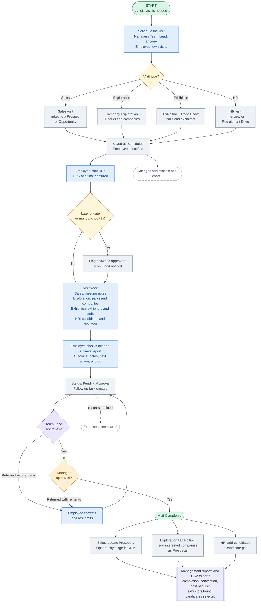
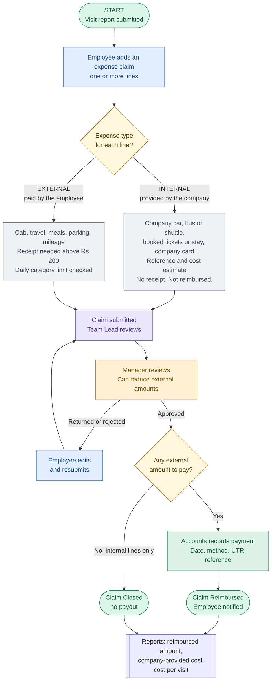
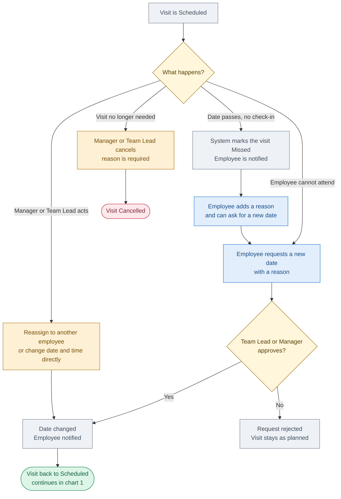

# Field Visit module: flowcharts (Mermaid)

Paste any block into mermaid.live, Notion, GitHub, Confluence or draw.io (Arrange > Insert > Advanced > Mermaid).

## Chart 1: Visit flow (plan to approval)

## Chart 2: Expense flow (internal and external)

## Chart 3: Reschedule, missed and cancelled visits

